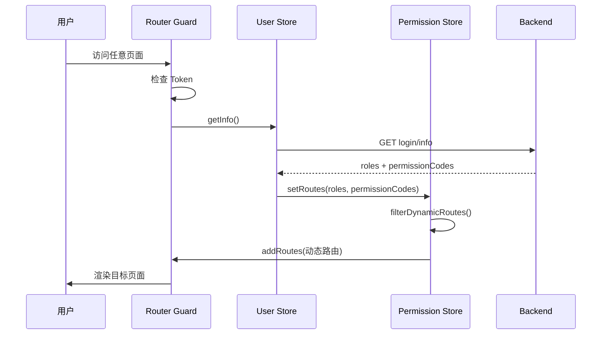
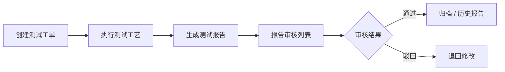

# COSL 测试管理系统 — 框架与功能结构文档

> 基于 v3-admin-vite 模板构建的中后台 Web 前端，面向 COSL 测试管理业务场景。

---

## 1. 项目概述

| 项目 | 说明 |
|------|------|
| 项目名称 | cosl-front-rebuild（v3-admin-vite） |
| 业务定位 | COSL 测试管理系统 Web 端 |
| 后端依赖 | cnooc-backend（Django） |
| 关联客户端 | cosl-operator-tauri（桌面客户端） |
| 包管理 | pnpm |
| 开发端口 | 3333 |

---

## 2. 技术栈

| 层级 | 技术 | 版本 | 用途 |
|------|------|------|------|
| 框架 | Vue | 3.4 | 视图层 |
| 语言 | TypeScript | 5.4 | 类型安全 |
| 构建 | Vite | 5.2 | 开发/打包 |
| UI | Element Plus | 2.8 | 基础组件 |
| 表格 | vxe-table | 4.6 | 复杂表格 |
| 状态 | Pinia | 2.1 | 全局状态 |
| 路由 | Vue Router | 4.3 | SPA 路由 |
| CSS | UnoCSS + SCSS | — | 原子化 + 主题 |
| 图表 | ECharts | 5.5 | 数据可视化 |
| HTTP | Axios | 1.7 | API 请求 |
| 测试 | Vitest | 1.6 | 单元测试 |

**其他重要依赖：** `@element-plus/icons-vue`、`lodash-es`、`dayjs`、`qrcode`、`vue-draggable-plus`、`tui-image-editor`、`vexip-ui`、`screenfull`、`mitt`

---

## 3. 系统架构

```
┌─────────────────────────────────────────────────────────────┐
│                        浏览器 (SPA)                          │
├─────────────────────────────────────────────────────────────┤
│  Views (页面)          │  Components (公共组件)              │
├────────────────────────┼────────────────────────────────────┤
│  Layouts (布局)        │  Hooks / Directives (组合逻辑)      │
├────────────────────────┴────────────────────────────────────┤
│  Router (路由)  ←→  Permission Guard (权限守卫)             │
├─────────────────────────────────────────────────────────────┤
│  Pinia Store (user / permission / app / settings / …)       │
├─────────────────────────────────────────────────────────────┤
│  API Layer (src/api/*)  →  Axios Service (utils/service.ts)  │
└───────────────────────────────┬─────────────────────────────┘
                                │ Bearer Token + JSON
                                ▼
                    cnooc-backend (Django REST API)
                    VITE_BASE_API (如 http://127.0.0.1:60034/)
```

### 3.1 应用启动流程

```
main.ts
  ├── createApp(App)
  ├── loadPlugins()      → Element Plus / vxe-table / Icons
  ├── loadSvg()          → SVG 图标注册
  ├── loadDirectives()   → v-permission 指令
  ├── app.use(store)     → Pinia
  ├── app.use(router)    → Vue Router
  └── router.isReady() → mount("#app")

router/permission.ts (全局前置守卫)
  ├── 无 Token → 白名单放行 / 否则跳转 /login
  ├── 有 Token 访问 /login → 重定向首页
  ├── 已有 roles → 直接放行
  └── 首次登录 → getInfo() → 按角色/权限过滤动态路由 → addRoute()
```

### 3.2 路由分层

| 类型 | 定义位置 | 说明 |
|------|----------|------|
| 常驻路由 | `constantRoutes` | 登录后即可访问（首页、装备管理、巡检等） |
| 动态路由 | `dynamicRoutes` | 需角色/权限码匹配后才注入（测试管理、数据管理、权限管理） |

路由配置开关（`src/config/route.ts`）：

- `dynamic: true` — 开启动态路由，按用户 roles + permissionCodes 过滤
- `thirdLevelRouteCache: false` — 三级路由缓存（当前关闭）

---

## 4. 目录结构

```
cosl-front-rebuild/
├── src/
│   ├── api/              # API 请求模块（按业务域划分，含 types/）
│   ├── assets/           # 静态资源（图片、SVG 等）
│   ├── components/       # 全局公共组件
│   ├── config/           # 路由、布局、白名单等配置
│   ├── constants/        # 常量（权限码、缓存 Key 等）
│   ├── directives/       # 自定义指令（v-permission）
│   ├── hooks/            # 组合式函数
│   ├── icons/            # SVG 图标资源
│   ├── layouts/          # 布局框架（侧边栏、顶栏、TagsView 等）
│   ├── plugins/          # Vue 插件注册
│   ├── router/           # 路由定义 + 权限守卫
│   ├── store/            # Pinia 状态模块
│   ├── styles/           # 全局样式与主题
│   ├── utils/            # 工具函数（HTTP、缓存、校验、权限等）
│   ├── views/            # 页面视图（按业务模块组织）
│   ├── App.vue
│   └── main.ts
├── types/                # 全局 TypeScript 类型声明
├── tests/                # Vitest 单元测试
├── docs/                 # 项目文档
├── .env.development      # 开发环境变量
├── .env.staging          # 测试环境变量
├── .env.production       # 生产环境变量
├── vite.config.ts
└── unocss.config.ts
```

---

## 5. 核心模块说明

### 5.1 HTTP 请求层 (`src/utils/service.ts`)

- 基于 Axios 封装 `request<T>()` 方法
- 自动注入 `Authorization: Bearer {token}`
- `baseURL` 来自环境变量 `VITE_BASE_API`
- 业务约定：`code === 0` 表示成功；`401` 触发登出并刷新页面
- 支持 `blob` / `arraybuffer` 二进制响应

**API 模块规范**（以 `src/api/login/index.ts` 为例）：

```typescript
export function loginApi(data: LoginRequestData) {
  return request<LoginResponseData>({
    url: "login/login",
    method: "post",
    data
  })
}
```

每个 API 域独立目录，类型定义放在同级 `types/` 下。

### 5.2 状态管理 (Pinia)

| Store 模块 | 文件 | 职责 |
|------------|------|------|
| user | `store/modules/user.ts` | Token、用户信息、roles、permissionCodes、登录/登出 |
| permission | `store/modules/permission.ts` | 动态路由过滤与注入 |
| app | `store/modules/app.ts` | 侧边栏折叠、设备类型等 |
| settings | `store/modules/settings.ts` | 主题、布局模式、TagsView、水印等 |
| tags-view | `store/modules/tags-view.ts` | 多页签访问记录与 keep-alive 缓存 |
| task-center | `store/modules/task-center.ts` | 待处理任务中心状态 |
| test | `store/modules/test.ts` | 测试相关共享状态 |

### 5.3 布局系统 (`src/layouts/`)

支持三种布局模式（通过 Settings 切换）：

- **LeftMode** — 经典左侧菜单
- **TopMode** — 顶部导航
- **LeftTopMode** — 混合模式

布局子组件：

| 组件 | 说明 |
|------|------|
| Sidebar | 侧边栏菜单（基于 permissionStore.routes 渲染） |
| NavigationBar | 顶栏（面包屑、用户菜单等） |
| TagsView | 多页签导航 + keep-alive |
| Logo / Footer / Settings | 品牌、页脚、系统设置面板 |

### 5.4 公共组件 (`src/components/`)

| 组件 | 用途 |
|------|------|
| Table | 通用表格封装（基于 vxe-table） |
| Form/FormComponent | 通用表单 |
| TaskCenter | 待处理任务面板与列表 |
| Check/* | 工艺/报告预览（ProcessPreview、ReportPreview 等） |
| SearchMenu | 全局菜单搜索 |
| Echarts | 图表封装 |
| imgEditor | 图片编辑器（tui-image-editor） |
| SvgIcon / ThemeSwitch / Screenfull / Notify | 基础 UI 增强 |

### 5.5 Hooks (`src/hooks/`)

| Hook | 用途 |
|------|------|
| usePagination | 分页逻辑 |
| useFullscreenLoading | 全屏 Loading |
| useRouteListener | 路由变化监听 |
| useTitle | 页面标题 |
| useTheme / useLayoutMode / useDevice | 主题与响应式 |
| useWatermark | 系统水印 |
| useFetchSelect | 远程下拉数据 |

### 5.6 权限体系

**双重鉴权机制：**

1. **路由级** — `meta.roles` 或 `meta.permissions`，在 `permissionStore.filterDynamicRoutes` 中过滤
2. **按钮/Tab 级** — `v-permission` 指令 + `checkPermission()` 工具函数

**权限码定义**（`src/constants/permission.ts`）：

| 分类 | 权限码 |
|------|--------|
| 工艺 | `TEST_PROCESS_CREATE`、`TEST_PROCESS_REVIEW` |
| 工单创建 | `TEST_ORDER_CREATE_BASIC`、`…_HALT_HASS`、`…_WATER_CYCLE`、`…_HIGH_TEMP_BOX`、`…_VIBRATION_TABLE`、`…_HIGH_TEMP_PRESSURE`、`…_SIMULATED_WELL` |
| 报告审核 | `REPORT_REVIEW_BASIC`、`…_HALT_HASS`、`…_WATER_CYCLE`、`…_HIGH_TEMP_BOX`、`…_VIBRATION_TABLE`、`…_HIGH_TEMP_PRESSURE`、`…_SIMULATED_WELL` |
| 系统管理 | `USER_MANAGE`、`ROLE_MANAGE`、`SIGNATURE_MANAGE` |

---

## 6. 功能模块结构

### 6.1 功能总览

```
COSL 测试管理系统
├── 首页
│   ├── 待处理任务中心
│   └── 数据看板
├── 测试装备管理
│   ├── 装备管理（实例）
│   └── 装备型号管理
├── 巡检管理
│   ├── 巡检信息查看
│   └── 巡检信息添加
├── 测试管理 ★
│   ├── 测试工单列表
│   ├── 疑问工单列表
│   ├── 测试工艺列表
│   ├── 工艺审核列表
│   ├── 测试类型列表
│   └── 测试缺陷列表
├── 数据管理 ★
│   ├── 工时管理
│   ├── 测试报告管理
│   ├── 模拟井数据管理
│   ├── 报告审核列表
│   ├── 数据归档与回溯
│   └── 委托单管理
└── 权限管理 ★
    ├── 用户管理
    ├── 角色管理
    └── 签名管理

★ 标记为动态路由模块，需权限匹配
（部分日常管理模块当前 hidden）
```

### 6.2 首页 (`/`)

| 路由 | 页面 | 功能 |
|------|------|------|
| `/dashboard` | `views/dashboard/index.vue` | 待处理任务中心（TaskPanel 组件） |
| `/data-board` | `views/dashboard/data-board.vue` | 数据看板（ECharts 统计） |

### 6.3 测试装备管理 (`/devicemanage`)

#### 装备管理（设备实例）

| 路由 | 页面 | 功能 |
|------|------|------|
| `/devicemanage/device/boards` | 电路板管理 | 电路板实例 CRUD |
| `/devicemanage/device/instrument` | 仪器管理 | 仪器实例管理 |
| `/devicemanage/device/fixtures` | 夹具管理 | 夹具实例管理 |
| `/devicemanage/device/psi` | 主机管理 | PSI 主机实例 |
| `/devicemanage/device/equipments` | 其他设备管理 | 通用设备实例 |

#### 装备型号管理

| 路由 | 页面 | 功能 |
|------|------|------|
| `…/boardmodel` | 电路板型号 | 电路板型号定义 |
| `…/boardgroup` | 电路板组 | 电路板分组 |
| `…/fixturemodel` | 夹具型号 | 夹具型号定义 |
| `…/psimodel` | 主机型号 | PSI 型号定义 |
| `…/instrumentDevice` | 仪器型号 | 仪器型号定义 |
| `…/product` | 产品型号 | 产品型号定义 |
| `…/equipmenttype` | 其他设备型号 | 通用设备型号 |

**关联 API：** `board`、`boardmodel`、`boardgroup`、`instrument`、`instrument-model`、`fixture`、`fixturemodel`、`psi`、`psimodel`、`product`、`otherModelType`、`device-instance`

### 6.4 巡检管理 (`/inspectionmanage`)

| 路由 | 功能 |
|------|------|
| `/inspectionmanage/view` | 巡检信息查看 |
| `/inspectionmanage/base-info` | 巡检信息添加 |

**关联 API：** `inspection-base`、`Annualinspection`

### 6.5 测试管理 (`/testmanage`) — 核心业务

| 路由 | 页面 | 功能 |
|------|------|------|
| `testorder` | 测试工单列表 | 多类型工单 Tab（见下表） |
| `Questionlist` | 疑问工单列表 | 测试疑问项跟踪 |
| `testprocess` | 测试工艺列表 | 工艺浏览与管理 |
| `check` | 工艺审核列表 | 待审核工艺 |
| `addprocess` | 测试工艺编辑 | 工艺创建/编辑（隐藏路由） |
| `checktestlist` | 工艺审核详情 | 单条工艺审核（隐藏路由） |
| `testTypelist` | 测试类型列表 | 测试类型配置 |
| `Faultlist` | 测试缺陷列表 | 缺陷项管理 |
| `testmonitor` | 测试进度监控 | 测试执行监控（隐藏） |
| `halt-hass/*` | HALT-HASS 工艺/工单/报告 | 已集成到主列表，独立路由隐藏 |

#### 测试工单类型（Tab 权限隔离）

| Tab | 组件 | 权限码 |
|-----|------|--------|
| 生产测试工单 | ProdOrder | `TEST_ORDER_CREATE_BASIC` |
| 临时测试工单 | TempOrder | `TEST_ORDER_CREATE_BASIC` |
| HALT-HASS 工单 | HaltHassOrder | `TEST_ORDER_CREATE_HALT_HASS` |
| 水循环工单 | WaterCycleOrder | `TEST_ORDER_CREATE_WATER_CYCLE` |
| 高温箱工单 | HighTemperatureOrder | `TEST_ORDER_CREATE_HIGH_TEMP_BOX` |
| 振动台工单 | VibrationOrder | `TEST_ORDER_CREATE_VIBRATION_TABLE` |
| 高温高压井工单 | HighTemperaturePressureOrder | `TEST_ORDER_CREATE_HIGH_TEMP_PRESSURE` |
| 模拟井工单 | SimulationOrder | `TEST_ORDER_CREATE_SIMULATED_WELL` |

**关联 API：** `testMangelist`、`addprocess`、`check`、`testtype`、`question-item`、`questionunit`、`defect-item`、`halt-hass`、`water-cycle`、`high-temperature`、`high-temp-pressure`、`vibration-table`、`simulated-well`、`temp-board`、`temp-batch`、`batch`、`engineer-assistant`

### 6.6 数据管理 (`/datamanage`)

| 路由 | 功能 |
|------|------|
| `work-time` | 工时管理（需 role 15） |
| `report` | 测试报告管理（历史报告浏览） |
| `simulated-well-data-manage` | 模拟井数据管理（报告模板、仪器型号/实例、使用维保） |
| `reportCheckList` | 报告审核列表（多类型 Tab） |
| `datastore` | 数据归档与回溯 |
| `check-item-lib-list` | 检测项库 |
| `defect-item-lib-list` | 缺陷项库 |
| `questionItemLibList` | 疑问项库 |
| `ordermanage/*` | 委托单管理（新增、关联汇总、数据管理） |

#### 报告审核类型（Tab 权限隔离）

| Tab | 权限码 |
|-----|--------|
| 常规报告 | `REPORT_REVIEW_BASIC` |
| HALT-HASS | `REPORT_REVIEW_HALT_HASS` |
| 水循环 | `REPORT_REVIEW_WATER_CYCLE` |
| 高温箱 | `REPORT_REVIEW_HIGH_TEMP_BOX` |
| 振动台 | `REPORT_REVIEW_VIBRATION_TABLE` |
| 高温高压井 | `REPORT_REVIEW_HIGH_TEMP_PRESSURE` |
| 模拟井 | `REPORT_REVIEW_SIMULATED_WELL` |

**关联 API：** `report`、`work-time`、`check-item`、`defect-item`、`question-item`、`halt-hass`、`water-cycle-report`、`high-temp-box-report`、`high-temp-pressure-report`、`vibration-table-report`、`simulated-well-report`、`simulated-well-report-template`、`sim-instrument`、`sim-maintenance`、`file`、`signature`

### 6.7 权限管理 (`/permission`)

| 路由 | 功能 | 权限 |
|------|------|------|
| `user` | 用户管理 | `USER_MANAGE` (role 18) |
| `role` | 角色管理 | `ROLE_MANAGE` (role 19) |
| `signature` | 签名管理 | `SIGNATURE_MANAGE` |

**关联 API：** `user`、`role`、`permission`、`signature`

### 6.8 其他页面

| 路由 | 说明 |
|------|------|
| `/login` | 登录页 |
| `/403` / `/404` | 错误页 |
| `/redirect/:path` | 路由刷新重定向 |
| `/signature/my` | 我的签名（隐藏菜单） |

---

## 7. API 模块索引

按业务域整理的 API 模块（`src/api/`）：

| 域 | 模块 |
|----|------|
| 认证 | `login` |
| 用户权限 | `user`、`role`、`permission` |
| 装备实例 | `board`、`instrument`、`fixture`、`psi`、`device-instance`、`othermodel` |
| 装备型号 | `boardmodel`、`boardgroup`、`fixturemodel`、`psimodel`、`instrument-model`、`product`、`otherModelType` |
| 测试工艺 | `addprocess`、`check`、`testtype`、`halt-hass` |
| 测试工单 | `testMangelist`、`batch`、`temp-batch`、`temp-board` |
| 专项测试 | `water-cycle`、`high-temperature`、`high-temp-pressure`、`vibration-table`、`simulated-well` |
| 报告 | `report`、`halt-hass`、`water-cycle-report`、`high-temp-box-report`、`high-temp-pressure-report`、`vibration-table-report`、`simulated-well-report` |
| 数据库 | `check-item`、`defect-item`、`question-item`、`questionunit` |
| 模拟井 | `sim-instrument`、`sim-maintenance`、`simulated-well-report-template` |
| 巡检 | `inspection-base`、`Annualinspection`、`everytest/Dailyinspections` |
| 其他 | `work-time`、`task-center`、`signature`、`file`、`qrcode`、`screen`、`engineer-assistant` |

---

## 8. 环境配置

| 变量 | 说明 | 示例 |
|------|------|------|
| `VITE_BASE_API` | 后端 API 根地址 | `http://127.0.0.1:60034/` |
| `VITE_ROUTER_HISTORY` | 路由模式 | `hash` / `html5` |
| `VITE_PUBLIC_PATH` | 部署路径前缀 | `/` |

### 常用命令

```bash
pnpm install      # 安装依赖
pnpm dev          # 开发环境 (localhost:3333)
pnpm build:prod   # 生产构建
pnpm build:stage  # 测试环境构建
pnpm lint         # ESLint + Prettier
pnpm test         # Vitest 单元测试
```

---

## 9. 开发规范摘要

1. **组件语法** — 统一使用 `<script setup lang="ts">`
2. **注释语言** — 中文
3. **类型定义** — 放在各 API 模块的 `types/` 或根目录 `types/`
4. **API 请求** — 统一通过 `src/api/` 模块 + `request()` 封装
5. **权限控制** — 路由用 `meta.permissions`；页面内 Tab/按钮用 `checkPermission()` 或 `v-permission`
6. **样式** — 全局 SCSS 主题 + UnoCSS 原子类；组件内 scoped SCSS
7. **表格** — 优先使用 `components/Table`（vxe-table 封装）
8. **分页** — 使用 `usePagination` Hook

---

## 10. 关键数据流示意

### 登录 → 权限路由



### 测试工单 → 报告审核



---

## 11. 扩展指南

| 场景 | 操作步骤 |
|------|----------|
| 新增页面 | 1. 在 `views/` 创建 Vue 组件<br>2. 在 `router/index.ts` 注册路由<br>3. 如需权限，设置 `meta.permissions`<br>4. 在 `api/` 添加接口模块 |
| 新增工单/报告类型 | 1. 在 `constants/permission.ts` 添加权限码<br>2. 路由 meta 引用新权限码<br>3. 在 testorder/report 页面添加 Tab 组件<br>4. 新建 API 模块与类型 |
| 新增公共组件 | 放入 `src/components/`，按功能分子目录 |
| 修改主题 | `src/styles/theme/` 下 dark / dark-blue 等主题变量 |

---

*文档生成时间：2026-06-08 · 基于当前代码库静态分析*
